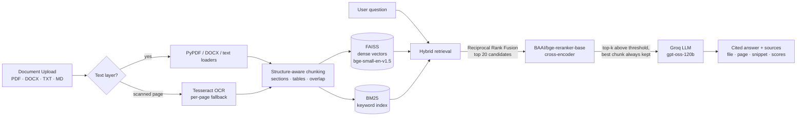

# SiteQuery

**A RAG-powered assistant that answers questions about construction documents, with every claim cited back to the file and page it came from.**

Upload RFIs, specifications, submittals and meeting minutes. Ask in plain English. Get a grounded answer
with `[n]` citations, clickable to the exact source passage, and an honest "the documents don't say" when they don't.

`FastAPI` · `Streamlit` · `FAISS` · `BM25` · `FastEmbed` · `BAAI/bge-reranker-base` · `Tesseract OCR` · `Groq gpt-oss-120b` · `Docker`

## Impact in AEC

Project knowledge in construction lives in hundreds of PDFs that nobody has time to re-read: a 400-page spec book,
a running RFI log, weekly OAC minutes. The cost of not finding the right paragraph is real.

| Pain point | What SiteQuery does |
| --- | --- |
| **RFI lookups.** "Did we already ask the EOR about this? What did they say?" means grepping logs and email threads. | Ask the question directly. The answer cites the RFI number, response and status. |
| **Spec conflicts.** Drawing says 15 ft joint spacing, spec says 12 ft. Finding both takes a while. | Hybrid retrieval surfaces both passages; the model is instructed to flag conflicts and cite each. |
| **Exact identifiers.** `RFI-0141`, `ASTM C39`, `03 30 00` are poorly served by pure semantic search. | BM25 runs alongside vector search, so exact IDs match as reliably as paraphrases. |
| **Scanned submittals.** Image-only PDFs are invisible to normal search. | Pages with little embedded text fall back to per-page OCR. |
| **Trust.** A confident wrong answer about a rebar spec is worse than no answer. | Answers are grounded only in retrieved text, cite their sources, and say so when the context lacks the answer. |

Every question answered in seconds instead of minutes of searching adds up across a project team of engineers,
superintendents and estimators: fewer interruptions of the one person who "knows where that is", fewer
re-asked RFIs, and fewer field decisions made on a half-remembered spec.

## Architecture



**Ingestion** validates every upload (extension allow-list, magic bytes, streamed size cap, SHA-256 dedupe), extracts text,
splits it along document structure, embeds locally with FastEmbed (ONNX, no API key), and writes to FAISS and a BM25 index.

**Retrieval** fuses dense and sparse rankings with RRF, then a local cross-encoder reads each (question, chunk) pair
jointly and re-scores the candidates. Chunks below `RERANK_THRESHOLD` are dropped, but **the single best chunk is
always kept**: cross-encoders under-score casual phrasing, and it is better to hand the LLM the best available context and let it say
"the documents do not contain this" than to short-circuit with an empty result.

**Generation** uses Groq's `openai/gpt-oss-120b` at temperature 0. The prompt treats retrieved text as data, never as instructions.

## Quickstart (Docker Compose)

```bash
# 1. Configure: copy the template, then set GROQ_API_KEY in .env (free key: https://console.groq.com/keys)
cp .env.example .env

# 2. Build and start (first run downloads ~1.1 GB of local models, so allow a few minutes)
docker compose up --build

# 3. Open the UI and ask: "What is the status of RFI-0141?"
#    UI  http://localhost:8501     API docs  http://localhost:8000/docs
```

On first start, if the index is empty, SiteQuery automatically indexes the two documents in
[`sample_data/`](sample_data/) (a fictional site safety protocol and a structural concrete RFI log), so you can
query immediately without uploading anything. Set `SEED_SAMPLE_DATA=false` to disable.

Try these:

- *What is the status of RFI-0141 and when is the Level 4 pour?*
- *What temperature must concrete be kept at in cold weather?*
- *At what height is fall protection required?*
- *How tall do guardrail top rails need to be?*
- *What's the wind limit for crane lifts?*
- *What is the paint colour for the lobby?* (not in the documents; expect an honest "not found")

Uploads, the FAISS index and the model cache are bind-mounted under `data/`, so they survive `docker compose down`.

## API

| Endpoint | Purpose |
| --- | --- |
| `POST /upload_document` | multipart `file` (PDF, DOCX, TXT, MD) → parse, chunk, embed, index |
| `POST /query` | `{question, history?, top_k?, document_ids?}` → `{answer, sources[]}` |
| `GET /documents`, `DELETE /documents/{id}` | manage the library |
| `GET /`, `GET /health` | liveness; counts and whether an API key is configured |

Each source in a `/query` response carries:

| Field | Meaning |
| --- | --- |
| `relevance` | Normalised RRF rank agreement (0..1) |
| `rerank_score` | Cross-encoder relevance, sigmoid of the logit (0..1); `null` if reranking is off |
| `ocr` | `true` if the chunk text came from OCR rather than the PDF's text layer |

In the chat UI, citation markers like **[2]** are links: clicking one scrolls to and expands the matching source card
(clicking a card also expands it), which shows its rerank score and a *Native text* / *OCR* badge.

## Configuration

All settings are environment variables (see [`.env.example`](.env.example)). The ones you are most likely to touch:

| Variable | Default | Notes |
| --- | --- | --- |
| `GROQ_API_KEY` | – | Required for Q&A. Uploads and indexing work without it. |
| `GROQ_MODEL` | `openai/gpt-oss-120b` | Reasoning tokens count against `GROQ_MAX_TOKENS`. |
| `RERANK_MODEL` | `BAAI/bge-reranker-base` | Any FastEmbed-supported cross-encoder, e.g. `BAAI/bge-reranker-v2-m3-int8`. |
| `RERANK_THRESHOLD` | `0.10` | Chunks below this are dropped, except the top-1 fallback. |
| `RERANK_ENABLED` | `true` | `false` skips the reranker download and uses RRF order. |
| `SEED_SAMPLE_DATA` | `true` | Index `sample_data/` on startup if the index is empty. |

## Data and recovery

The FAISS index and the document manifest (`documents.json`) live in `data/index/`. The API checks them on startup
and **refuses to start** rather than serve from a doubtful store:

- **Corrupt or inconsistent index**, or an index built with a different `EMBEDDING_MODEL` than the one configured:
  startup fails with an explanatory error. Switch back to the original model, or re-upload your documents into a fresh index.
- **Corrupt manifest:** the unreadable file is moved aside as `documents.json.corrupt` (numbered if one already exists)
  and startup fails, so nothing is silently reset.
- **Index and manifest out of step** (e.g. after a crash mid-write): vectors with no manifest entry are dropped and
  documents with missing chunks are logged as a warning; startup continues.

## Evaluation

`eval/` holds a synthetic benchmark (4 construction documents, 10 question / ground-truth pairs).

```bash
pip install -r eval/requirements.txt
python -m eval.evaluate_rag --compare           # hybrid vs hybrid + reranker, writes eval/reports/latest.md
python -m eval.evaluate_rag --retrieval-only    # no LLM calls; hit@k and MRR only
# or inside the API container (uses the cached models and GROQ_API_KEY):
docker compose run --rm -v ./eval:/app/eval api python -m eval.evaluate_rag --compare
```

It indexes the benchmark documents into a temporary directory (your `data/` is untouched) and reports
**Faithfulness**, **Answer relevance**, **Context precision** (LLM-judged) and deterministic **hit@k / MRR**.
Judge and generator are the same Groq model, so scores are optimistic, and the set is small: treat it as a regression
check, not proof of production quality. The committed `eval/reports/latest.md` predates the switch to
`BAAI/bge-reranker-base` and the top-1 fallback; regenerate it with `--compare`.

## Local development

Python 3.11+, plus `tesseract-ocr` and `poppler-utils` for OCR:

```bash
pip install -r backend/requirements.txt -r frontend/requirements.txt
uvicorn backend.main:app --reload --port 8000
streamlit run frontend/app.py
```

Tests and type checks need no API key or model downloads:

```bash
pip install -r requirements-dev.txt
pytest
mypy                  # strict; config in pyproject.toml
```

See [`CLAUDE.md`](CLAUDE.md) and [`.claude/rules/`](.claude/rules/) for conventions.

## Roadmap

Auth and multi-project tenancy · OCR layout/table recovery for drawings · structured RFI extraction (status, due date,
spec section) · streaming responses · calibrated rerank cutoff · larger evaluation set · observability.

*Sample documents are fictional and for demonstration only.*
